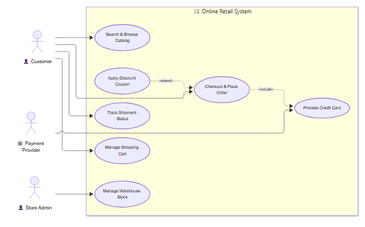
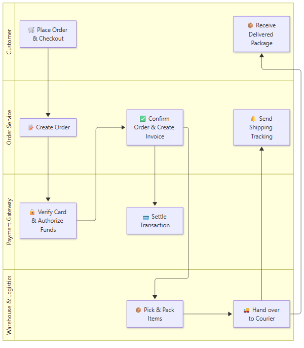

# System Architecture & Workflow Diagrams

This document contains high-resolution system diagrams rendered directly from Mermaid.js syntax using the **`mcp-mermaidjs-to-image`** MCP server running **Mermaid v12.3.0**.

---

## 1. E-Commerce Platform Use-Case Diagram

A native UML Use-Case diagram rendered with Mermaid's dedicated **`usecase-beta`** engine, featuring authentic UML stick figure actors, system boundary containers, and UML use case ovals.

### Rendered Diagram (High-DPI 2x Scale)



### Key UML Elements & Relationships

- **Actors (`actor Name("Label")`)**:
  - `👤 Customer`: Primary user actor interacting with catalog browsing, shopping cart, checkout, and tracking.
  - `👤 Store Admin`: Administrative actor managing inventory and platform operations.
  - `🏦 Payment Provider`: External secondary system actor handling card transaction settlements.
- **System Boundary (`systemBoundary "🛒 Online Retail System" ... end`)**: Encapsulates all platform-owned use cases.
- **`..> :include` Dependency**: `Checkout & Place Order` unconditionally includes `Process Credit Card`.
- **`..> :extend` Dependency**: `Apply Discount Coupon` conditionally extends `Checkout & Place Order`.

### Mermaid.js Source Code (`usecase-beta`)

```mermaid
usecase-beta
direction LR

actor Customer("👤 Customer")
actor Admin("👤 Store Admin")
actor PaymentGateway("🏦 Payment Provider")

systemBoundary "🛒 Online Retail System"
  Browse("Search & Browse Catalog")
  Cart("Manage Shopping Cart")
  Checkout("Checkout & Place Order")
  ProcessPayment("Process Credit Card")
  ApplyCoupon("Apply Discount Coupon")
  Shipment("Track Shipment Status")
  Inventory("Manage Warehouse Stock")
end

Customer --> Browse
Customer --> Cart
Customer --> Checkout
Customer --> Shipment

Admin --> Inventory
PaymentGateway --> ProcessPayment

Checkout ..> :include ProcessPayment
ApplyCoupon ..> :extend Checkout
```

---

## 2. Order Fulfillment Swimlanes Diagram

A native cross-functional swimlane process diagram rendered with Mermaid's dedicated **`swimlane-beta`** engine, featuring true parallel swimlane columns with styled lane headers and cross-lane handoffs.

### Rendered Diagram (High-DPI 2x Scale)



### Swimlane Roles & Responsibilities

1. **`Customer`**:
   - Initiates checkout and receives delivered physical package.
2. **`Order Service`**:
   - Creates the order, coordinates confirmation, invoices, and sends shipping tracking.
3. **`Payment Gateway`**:
   - Verifies 3D Secure credentials, authorizes funds, and captures settlement.
4. **`Warehouse & Logistics`**:
   - Picks inventory, packs boxes, and dispatches parcels to couriers.

### Mermaid.js Source Code (`swimlane-beta`)

```mermaid
swimlane-beta LR
subgraph Customer
  Order[🛒 Place Order & Checkout]
  Receive[📦 Receive Delivered Package]
end

subgraph Order Service
  CreateOrder[📝 Create Order]
  ConfirmOrder[✅ Confirm Order & Create Invoice]
  SendTracking[🔔 Send Shipping Tracking]
end

subgraph Payment Gateway
  Authorize[🔒 Verify Card & Authorize Funds]
  Capture[💳 Settle Transaction]
end

subgraph Warehouse & Logistics
  PickPack[📦 Pick & Pack Items]
  Dispatch[🚚 Hand over to Courier]
end

Order --> CreateOrder
CreateOrder --> Authorize
Authorize --> ConfirmOrder
ConfirmOrder --> Capture
ConfirmOrder --> PickPack
PickPack --> Dispatch
Dispatch --> SendTracking
Dispatch --> Receive
```
