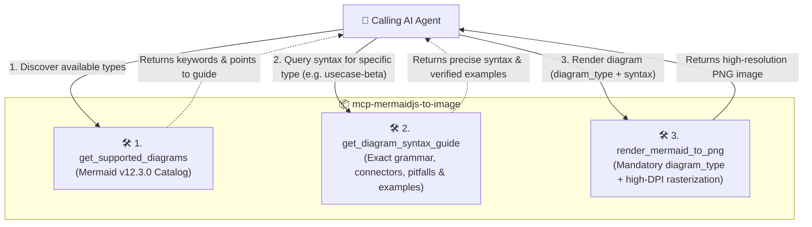

# mcp-mermaidjs-to-image

A high-performance **Model Context Protocol (MCP)** server that converts **Mermaid.js** diagram syntax into crisp, high-resolution **PNG** images. 

Powered by the official **Mermaid.js v12.3.0** engine, providing native support for **37+ diagram types** (including native UML Use-Case, Swimlanes, Cloud Architecture, Network Packets, Kanban, and more).

Compatible with **Antigravity**, **Cline**, **Codex**, **Claude Code**, **Cursor**, and **Claude Desktop**.

---

## Key Features

- **Latest Mermaid.js Engine (v12.3.0)**: Complete native support for all 37+ diagram types—UML Use-Case (`usecase-beta`), Swimlanes (`swimlane-beta`), Flowcharts, Sequence Diagrams, Class Diagrams, Cloud Architecture, Network Packets, Kanban, GitGraphs, Mindmaps, and more.
- **3-Step AI Workflow**: Implements a progressive disclosure architecture:
  1. `get_supported_diagrams`: Discover available keywords, aliases, and categories.
  2. `get_diagram_syntax_guide`: Retrieve precise grammar rules, connectors, and verified examples on demand.
  3. `render_mermaid_to_png`: Render crisp PNGs with mandatory keyword validation.
- **Mandatory Keyword Validation**: Rejects requests missing or having invalid `diagram_type`, returning a categorized list of available keywords to eliminate guesswork and syntax hallucinations.
- **Smart Alias Normalization**: Transparently maps aliases (`usecase` / `use-case` → `usecase-beta`, `swimlane` / `swimlanes` → `swimlane-beta`) across arguments and syntax headers.
- **Multimodal AI Ready**: Returns the rendered diagram directly as an MCP `image/png` block so multimodal AI assistants can visually inspect and verify their diagrams in real time.
- **AI-Optimized Verbose Diagnostics**: If syntax fails, returns actionable diagnostics with line numbers, code frames (`> Line N | ... ^`), and diagram-specific remediation hints with `isError: true` so the AI can self-correct immediately.
- **Sub-100ms Rendering**: Uses a persistent headless browser singleton with lazy initialization and an automatic 5-minute idle shutdown.
- **High-DPI Retina Output**: Renders at 2x scale by default (configurable up to 3x or 4x).
- **Flexible Themes & Looks**: Full support for all 11 Mermaid themes (`redux-color`, `redux-dark-color`, `redux`, `redux-dark`, `neo`, `neo-dark`, `default`, `neutral`, `dark`, `forest`, `base`) and modern rendering styles (`look: "classic" | "neo" | "handDrawn"`), with automatic dark-theme background pairing (`#1e1e2e` for dark themes, `white` for light themes) or custom/transparent overrides.
- **Zero Cloud Dependencies**: Runs 100% locally with automatic fallback to system Microsoft Edge or Google Chrome if needed.

---

## The 3-Step AI Agent Workflow

To avoid flooding the AI's context window while guaranteeing 100% syntax compliance, the server separates discovery, syntax knowledge, and image rasterization into three focused tools:



---

## MCP Tools Reference

### Tool 1: `get_supported_diagrams`

Returns the Mermaid.js engine version (`v12.3.0`) and the complete catalog of all 40 supported diagram types, keywords, aliases, and categories.

#### Parameters:
| Parameter | Type | Required | Description |
| :--- | :--- | :--- | :--- |
| `category` | `string` | No | Optional category filter: `"uml"`, `"architecture"`, `"planning"`, `"charts"`, `"grammar"` |
| `query` | `string` | No | Optional search keyword to filter by name, keyword, or description |

#### Output:
- Formatted markdown table of supported diagram types with accepted aliases and a guide prompt to query `get_diagram_syntax_guide`.

---

### Tool 2: `get_diagram_syntax_guide`

Returns authoritative syntax rules, keyword requirements, relationship connectors, common pitfalls, and verified working examples for any of the 40 supported diagram types.

#### Parameters:
| Parameter | Type | Required | Description |
| :--- | :--- | :--- | :--- |
| `diagram_type` | `string` | **Yes** | The diagram keyword or alias (e.g. `"usecase-beta"`, `"swimlane-beta"`, `"sequenceDiagram"`, `"architecture"`, `"flowchart"`, `"packet-beta"`) |

#### Output:
- Exact header declaration requirements (e.g. `usecase-beta\ndirection LR`).
- Core syntax elements and item declarations.
- Connector operators (e.g. `-->`, `..> :include`, `..> :extend`, `--|>`).
- Common pitfalls to avoid (e.g. *"Do NOT write `system { }`, use `systemBoundary ... end`"*).
- Minimal and complete verified working examples.

---

### Tool 3: `render_mermaid_to_png`

Converts Mermaid diagram syntax directly into a high-resolution PNG image.

#### Parameters:
| Parameter | Type | Required | Default | Description |
| :--- | :--- | :--- | :--- | :--- |
| `diagram_type` | `string` | **Yes** | — | Required diagram type keyword (e.g. `"usecase-beta"`, `"swimlane-beta"`, `"sequenceDiagram"`, `"flowchart"`) |
| `mermaid_syntax` | `string` | **Yes** | — | The Mermaid diagram code (e.g. `usecase-beta\n  actor User`) |
| `output_path` | `string` | No | `undefined` | Optional file path where the PNG will be saved on disk |
| `theme` | `string` | No | Engine default | Visual theme: `"default"`, `"neutral"`, `"dark"`, `"forest"`, `"base"`, `"neo"`, `"neo-dark"`, `"redux"`, `"redux-dark"`, `"redux-color"`, `"redux-dark-color"` |
| `look` | `string` | No | Engine default | Visual rendering look: `"classic"` (standard crisp lines), `"neo"` (modern flat style with rounded corners and subtle drop shadows), or `"handDrawn"` (sketch-like rough hand-drawn aesthetic) |
| `background` | `string` | No | `"white"` (or `"#1e1e2e"` for dark themes) | Background color: `"white"`, `"transparent"`, or hex code (`"#1e1e2e"`). Automatically pairs with `"#1e1e2e"` when omitted on dark themes (`dark`, `neo-dark`, `redux-dark`, `redux-dark-color`) |
| `scale` | `number` | No | `2` | Resolution scale factor (1 for standard, 2 for retina, 3 for ultra-crisp) |
| `width` | `number` | No | Auto | Viewport width hint in pixels |
| `height` | `number` | No | Auto | Viewport height hint in pixels |

#### Output:
- `image`: Base64-encoded `image/png` buffer for inline AI inspection.
- `text`: Execution summary with dimensions, scale factor, and saved path.

---

### Tool 4: `render_mermaid_file`

Reads a local `.mmd` or `.mermaid` file and renders it directly to a PNG file on disk.

#### Parameters:
| Parameter | Type | Required | Default | Description |
| :--- | :--- | :--- | :--- | :--- |
| `diagram_type` | `string` | **Yes** | — | Required diagram type keyword |
| `input_path` | `string` | **Yes** | — | Path to source `.mmd` or `.mermaid` file |
| `output_path` | `string` | **Yes** | — | Destination path for the `.png` file |
| `theme` | `string` | No | Engine default | Visual theme: `"default"`, `"neutral"`, `"dark"`, `"forest"`, `"base"`, `"neo"`, `"neo-dark"`, `"redux"`, `"redux-dark"`, `"redux-color"`, `"redux-dark-color"` |
| `look` | `string` | No | Engine default | Visual rendering look: `"classic"`, `"neo"`, or `"handDrawn"` |
| `background` | `string` | No | `"white"` (or `"#1e1e2e"` for dark themes) | Background color (`"white"`, `"transparent"`, or hex code) |
| `scale` | `number` | No | `2` | Resolution scale factor |
| `width` | `number` | No | Auto | Viewport width hint in pixels |
| `height` | `number` | No | Auto | Viewport height hint in pixels |

---

## Mandatory Keyword Validation & Rejection Protocol

To prevent syntax confusion and incorrect diagram type selection, `render_mermaid_to_png` and `render_mermaid_file` **strictly require** the `diagram_type` parameter.

If an AI passes an invalid or missing `diagram_type`, the tool immediately responds with `isError: true` and an informative rejection message:

```markdown
❌ **Diagram Render Rejected: Mandatory Diagram Type Missing or Invalid**

Unrecognized diagram type: "invalid_type".

Mermaid.js engine v12.3.0 requires an explicit `diagram_type` parameter to ensure accurate rendering and prevent syntax mismatch.

### Available Keywords by Category:
- **UML & Process**: `usecase-beta`, `swimlane-beta`, `flowchart`, `sequenceDiagram`, `classDiagram`, `stateDiagram-v2`, `erDiagram`, `agentflow-beta`
- **Architecture & Systems**: `architecture`, `C4Context`, `C4Container`, `C4Component`, `packet-beta`, `block-beta`, `flowchart-elk`, `eventmodeling`, `wardley-beta`
- **Project Planning**: `gantt`, `timeline`, `kanban`, `gitGraph`, `journey`
- **Charts & Visual Analytics**: `pie`, `quadrantChart`, `xychart-beta`, `sankey-beta`, `mindmap`, `radar-beta`, `venn-beta`, `treemap`, `ishikawa-beta`, `cynefin-beta`
- **Grammar & Specs**: `railroad-beta`, `railroad-ebnf-beta`, `railroad-abnf-beta`, `railroad-peg-beta`, `requirementDiagram`, `treeView-beta`

💡 **How to proceed**:
1. Call `get_supported_diagrams` to browse all diagram options and accepted aliases.
2. Call `get_diagram_syntax_guide({ diagram_type: "<keyword>" })` to retrieve exact syntax rules and verified examples.
3. Provide the valid `diagram_type` alongside your `mermaid_syntax` to render your diagram.
```

---

## Supported Diagram Types (Mermaid v12.3.0)

| Category | Canonical Keywords | Accepted Aliases |
| :--- | :--- | :--- |
| **UML & Process** | `usecase-beta`<br>`swimlane-beta`<br>`flowchart`<br>`sequenceDiagram`<br>`classDiagram`<br>`stateDiagram-v2`<br>`erDiagram`<br>`agentflow-beta` | `usecase`, `use-case`<br>`swimlane`, `swimlanes`<br>`graph`, `flow`<br>`sequence`<br>`class`<br>`stateDiagram`, `state`<br>`er`<br>`agentflow` |
| **Architecture & Systems** | `architecture`<br>`C4Context`<br>`C4Container`<br>`C4Component`<br>`C4Dynamic`<br>`C4Deployment`<br>`packet-beta`<br>`block-beta`<br>`flowchart-elk`<br>`eventmodeling`<br>`wardley-beta` | `architecture-beta`, `arch`<br>`c4`, `c4-context`<br>`c4container`<br>`c4component`<br>`c4dynamic`<br>`c4deployment`<br>`packet`<br>`block`<br>`elk`<br>`eventmodel`<br>`wardley` |
| **Project Planning** | `gantt`<br>`timeline`<br>`kanban`<br>`gitGraph`<br>`journey` | `ganttchart`<br>`time-line`<br>`kanbanboard`<br>`git`<br>`userjourney`, `journeyMap` |
| **Charts & Visual Analytics** | `pie`<br>`quadrantChart`<br>`xychart-beta`<br>`sankey-beta`<br>`mindmap`<br>`radar-beta`<br>`venn-beta`<br>`treemap`<br>`ishikawa-beta`<br>`cynefin-beta` | `piechart`<br>`quadrant`<br>`xychart`, `barchart`, `linechart`<br>`sankey`<br>`mind-map`<br>`radar`, `spiderchart`<br>`venn`<br>`treemapchart`<br>`ishikawa`, `fishbone`<br>`cynefin` |
| **Grammar & Specs** | `railroad-beta`<br>`railroad-ebnf-beta`<br>`railroad-abnf-beta`<br>`railroad-peg-beta`<br>`requirementDiagram`<br>`treeView-beta` | `railroad`<br>`ebnf`<br>`abnf`<br>`peg`<br>`requirement`<br>`treeview` |

---

## Quick Setup & Client Configurations

### 1. Build & Link Locally

```bash
git clone <repo-url> mcp-mermaidjs-to-image
cd mcp-mermaidjs-to-image
npm install
npm run build
npm link
```

Compiled entry point:
`c:\Users\Public\Downloads\projects\mcp-mermaidjs-to-image\dist\index.js`

---

### 2. Client Configurations

#### Antigravity
Add to your Antigravity MCP configuration (`~/.gemini/config/mcp_config.json`):

```json
{
  "mcpServers": {
    "mermaid-to-image": {
      "command": "node",
      "args": ["c:/Users/Public/Downloads/projects/mcp-mermaidjs-to-image/dist/index.js"],
      "disabled": false
    }
  }
}
```

#### Cline (`cline_mcp_settings.json`)
```json
{
  "mcpServers": {
    "mermaid-to-image": {
      "command": "node",
      "args": ["c:/Users/Public/Downloads/projects/mcp-mermaidjs-to-image/dist/index.js"]
    }
  }
}
```

#### Claude Code (CLI)
```bash
claude mcp add mermaid-to-image -- node c:/Users/Public/Downloads/projects/mcp-mermaidjs-to-image/dist/index.js
```

#### Codex / Cursor (`mcp.json`)
```json
{
  "mcpServers": {
    "mermaid-to-image": {
      "command": "node",
      "args": ["c:/Users/Public/Downloads/projects/mcp-mermaidjs-to-image/dist/index.js"]
    }
  }
}
```

#### Claude Desktop (`claude_desktop_config.json`)
```json
{
  "mcpServers": {
    "mermaid-to-image": {
      "command": "node",
      "args": ["c:/Users/Public/Downloads/projects/mcp-mermaidjs-to-image/dist/index.js"]
    }
  }
}
```

---

## Verbose Error Diagnostics Example

When an AI provides broken syntax (e.g. `B -- invalid syntax -- C`), the tool sets `isError: true` and responds with detailed markdown:

```markdown
❌ **Mermaid Render Failed: Syntax Error**

- **Diagram Type**: `graph`
- **Location**: Line 3

**Code Context**:
```
    1 | graph TD
    2 |     A[Start] --> B(Valid Step)
>   3 |     B -- invalid syntax -- C
      | ^
    4 |     C --> D[End]
```

**Error Details**:
Lexical error on line 3. Unrecognized text.
...nvalid syntax -- C    C --> D[End
-----------------------^

💡 **Remediation Hint**:
Check connector arrows (e.g. `-->`, `---`, `-.->`, `==>`). If you have labels on links, wrap them in pipes: `A -->|label| B` or use `A -- label --> B`. Ensure node labels containing special characters (brackets, parens, quotes) are enclosed in double quotes, e.g. `id["Node (Label)"]`.
```

---

## Testing

Run the automated test suites:

```bash
# 1. Renderer unit tests
npm test

# 2. Full MCP Tools protocol & validation test suite
node --import tsx test/mcp-tools-suite.test.ts
```

Output:
```text
🧪 Starting MCP Tools Test Suite...
✅ Connected to MCP Server via Stdio Transport.

--- Test 1: List Tools ---
Available tools: [
  'get_supported_diagrams',
  'get_diagram_syntax_guide',
  'render_mermaid_to_png',
  'render_mermaid_file'
]
✅ Test 1 Passed: All 4 tools registered.

--- Test 2: get_supported_diagrams ---
✅ Test 2 Passed: get_supported_diagrams returned engine version & catalog.

--- Test 3: get_diagram_syntax_guide (usecase-beta) ---
✅ Test 3 Passed: get_diagram_syntax_guide returned detailed grammar rules and examples.

--- Test 4: Rejection on Invalid diagram_type ---
✅ Test 4 Passed: Properly rejected invalid diagram_type and returned keyword feedback.

--- Test 5: Render Use-Case Diagram with Alias Normalization ---
✅ Test 5 Passed: Successfully normalized alias and rendered native UML Use-Case diagram to PNG.

--- Test 6: Render Swimlane Diagram ---
✅ Test 6 Passed: Successfully rendered native Swimlanes diagram to PNG.

--- Test 7: Verify Full Syntax Guides for All 40 Catalog Diagram Types ---
✅ Test 7 Passed: All 40 diagram types return rich, complete syntax guides.

--- Test 8: Smart Dark-Theme Background Pairing ---
✅ Test 8 Passed: Smart Dark-Theme Background Pairing works as expected.

🎉 ALL 8 TESTS PASSED SUCCESSFULLY!
```

---

## License

MIT
